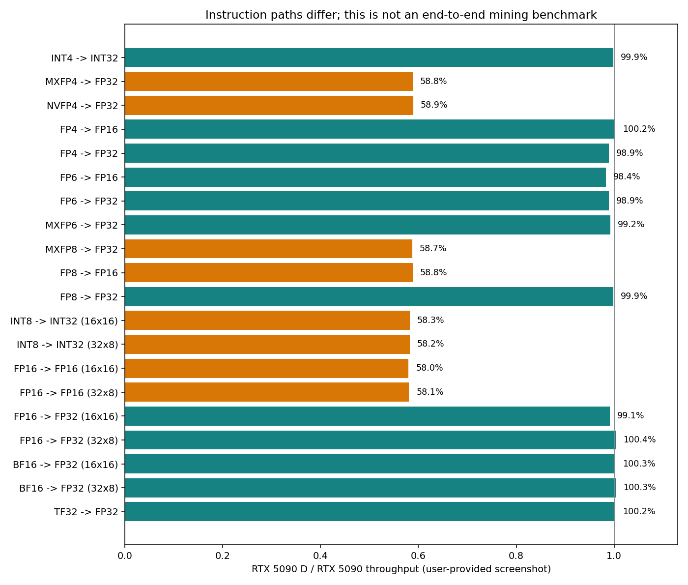
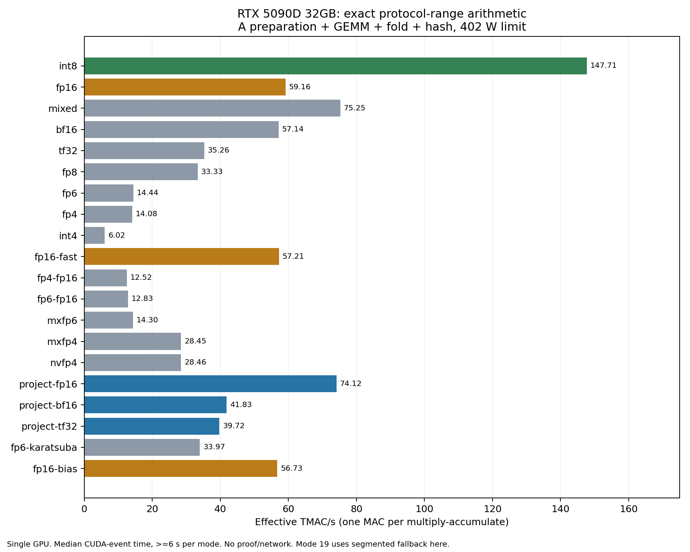

# RTX 5090D 32GB 的 PEARL 计算路径研究与 Windows 实验矿工

研究与本机验证日期：2026-11-04 至 2026-11-05。对象为最初的 **32GB RTX 5090D**，不包括 24GB 的 5090D v2。

本文把用户截图、公开项目源码、作者声明、本机测试和推断分别标明。实验版本没有更换驱动、刷固件或修改显卡的限制寄存器。

## 目前已经确认的内容

1. 用户提供的数据呈现的是**按指令及累加器类型区分的性能差异**。不能概括为“所有 AI 算力相同”或“所有 Tensor Core 算力都按同一比例削减”。
2. 一些 FP32 累加路径在截图中几乎相同，但这些路径的绝对吞吐本身低于 5090D 的 INT8 路径。相同不代表更快，也不表示相对专业卡没有限制。
3. 可以用 FP16 输入、FP32 分段累加精确得到 PEARL 所需的整数结果。实验实现已通过逐段 CPU 对照及完整本地份额验证；但首轮性能低于 INT8。
4. 已从 MIT 许可的 CPPminer 建立 GitHub fork，扩展到 22 个可选 CUDA 路径（其中包括对照与回退路径），编译出附带运行库的 Windows x64 EXE。**编译和正确性成功，不能据此宣称达到满血 5090 或优于 WildRig。**后文列出实测数据。
5. 当前 WildRig 的 Source code ZIP 是 GitHub 自动生成的仓库快照。0.51.9 的该 ZIP 只有一份 README，没有矿工 CUDA/C++ 源码。因此这次实现基于 CPPminer，而不是修改 WildRig 二进制后冒称源码版本。

Fork：https://github.com/laplacezz/CPPminer-5090D/tree/research/5090d-exact-tensor
上游：https://github.com/1640675651/CPPminer ，起点 ce8712a06fc38d73d6961070558ac2d1874e2728。

## 用户截图逐项说明

截图显示两卡均为170个SM、约31.8GiB可用显存，因而这不是简单的SM数量减少；仍需核对实际时钟、功率和指令路径。

以下为用户提供的截图数据，非我持有两张显卡重新做的同条件测试。时钟、功耗、驱动、编译器版本及输入初始化方式不完整，故比值描述这次测量，不是对所有运行环境的限速比例保证。

| 指令路径 | 5090D | 5090 | D / 完整版 | 单位 |
|---|---:|---:|---:|---|
| INT4 -> INT32 | 79.6 | 79.7 | 99.9% | TOPS |
| MXFP4 -> FP32 | 859.9 | 1462.4 | 58.8% | TFLOPS |
| NVFP4 -> FP32 | 861.6 | 1462.5 | 58.9% | TFLOPS |
| FP4 -> FP16 | 371.3 | 370.5 | 100.2% | TFLOPS |
| FP4 -> FP32 | 366.4 | 370.5 | 98.9% | TFLOPS |
| FP6 -> FP16 | 364.4 | 370.5 | 98.4% | TFLOPS |
| FP6 -> FP32 | 366.4 | 370.5 | 98.9% | TFLOPS |
| MXFP6 -> FP32 | 367.5 | 370.5 | 99.2% | TFLOPS |
| MXFP8 -> FP32 | 429.2 | 731.1 | 58.7% | TFLOPS |
| FP8 -> FP16 | 430.2 | 731.5 | 58.8% | TFLOPS |
| FP8 -> FP32 | 370.0 | 370.5 | 99.9% | TFLOPS |
| INT8 -> INT32 (16x16) | 430.9 | 739.7 | 58.3% | TOPS |
| INT8 -> INT32 (32x8) | 430.9 | 739.8 | 58.2% | TOPS |
| FP16 -> FP16 (16x16) | 428.9 | 739.7 | 58.0% | TFLOPS |
| FP16 -> FP16 (32x8) | 429.7 | 739.7 | 58.1% | TFLOPS |
| FP16 -> FP32 (16x16) | 367.4 | 370.6 | 99.1% | TFLOPS |
| FP16 -> FP32 (32x8) | 372.0 | 370.6 | 100.4% | TFLOPS |
| BF16 -> FP32 (16x16) | 371.6 | 370.6 | 100.3% | TFLOPS |
| BF16 -> FP32 (32x8) | 371.8 | 370.6 | 100.3% | TFLOPS |
| TF32 -> FP32 | 93.5 | 93.3 | 100.2% | TFLOPS |

- **明显有差距**：有缩放因子的 MXFP4、NVFP4、MXFP8；FP8 输入/FP16 累加；INT8/INT32；FP16/FP16。截图中 D 约为完整卡的 58%–59%。
- **截图中接近**：无缩放的 FP4/FP6、普通 FP8/FP32、FP16/FP32、BF16/FP32、TF32，以及这里测到的老 INT4 指令。
- MXFP8 与普通 FP8/FP32 不是同一条计算路径，不能互相代用峰值。FP16 输入、FP16 累加与 FP16 输入、FP32 累加也要分别报告。
- 整数运算应标 TOPS，不是 TFLOPS。乘加算两个操作的 Tensor 吞吐，与矿工把一次 MAC 记作一个单位的口径还要区分；更不能用寄存器循环吞吐冒充矿池确认算力。
- 接近 3000ms 的列是该测试的持续计时量级，不能解释为一次实际矩阵乘法耗时约三秒。

## 视频、评论和更新的测试方法

给定 B 站视频发布于 2025-05-09，长 968 秒，作者为青龙圣者。已取得视频元数据、作者简介中的结论和公开评论；没有取得完整字幕，不能声称逐句审阅了整段解说。作者简介的旧结论主要强调 FP4/FP8 混合精度；它不足以排除截图中 INT8、FP16 累加路径的差异。

视频评论中有作者/测试者指出，mmapeak 测的是 MMA 指令吞吐，缺少真实 GEMM 的访存开销。这个区分正确，而且本次生产尺寸实验也实际观察到它的重要性。

原始测试项目：https://github.com/ReinForce-II/mmapeak
更新的随机输入版本：https://github.com/KohakuBlueleaf/mmapeak
方法说明：https://github.com/KohakuBlueleaf/mmapeak/blob/main/docs/VALIDATION.md

更新版本指出：在其测试的 CUDA 13.2 / SM120a 编译条件下，编译期全零输入会使部分 FP16/BF16 WMMA 代码被合并，而旧计数仍按完整 tile 计算，从而可能产生虚高。**这不证明每个编译器都会同样优化，也不证明用户截图已确定受到这个问题影响；它意味着旧图的绝对数值需要重测。**

该随机版本使用运行时输入、独立输出、重复计时和中位数，并区分普通 FP8、MXFP8 等模式。它仍然重复使用寄存器中的操作数，不模拟完整 GEMM 的加载、折叠、证明和网络。

其 RTX5090 示例为单张已经超频的卡，Linux/CUDA13.2，并非同条件的 5090D 对照。示例中 FP16/FP32 274.7TFLOPS、INT8 545.7TOPS；这些值只用于提醒不同方法会给出不同绝对数值，不能拿来与用户旧图直接相除推断 D 的削减幅度。
来源：https://github.com/KohakuBlueleaf/mmapeak/blob/main/docs/RTX5090.md

更可靠的复测需要四层：

1. 相同系统、驱动、编译器、温度和实际时钟下，运行时非零输入的指令微测试，重复并取中位数。
2. 实际尺寸 GEMM，分别测试 INT8/INT32、FP16/FP32 等模式，说明计算和访存是否被计入。
3. PEARL 完整流程，包括矩阵生成、噪声、逐段累加折叠、哈希与证明；使用整数参考及正式验证器校验。
4. 同一矿池和难度定义下的长时间有效份额、拒绝/过期比例、GPU 实际功率及插座功率。短测一次接受只证明协议链路工作，不能给出可靠的长期矿池平均算力。

## 为什么 AI 推理可以接近，挖矿却不同

AI 推理不只包含矩阵计算。低并发逐 token 解码可能受显存带宽、权重读取、CPU 调度和小矩阵启动开销限制。即使程序标着 INT4/INT8 量化权重，也可能在计算前解量化，实际调用 FP16/BF16、FP32 累加的 GEMM；量化文件格式不等于最终使用的 Tensor 指令。

PEARL 的整数密集矩阵计算则持续使用整数路径。若恰好落在 D 较慢的指令类别，差距就会明显。换成 BF16 输入、FP32 累加的 AI 测试，接近的结果与这个现象并不矛盾。

目前不能把 D 的差距归结为“普通驱动软件中的一个可改开关”。RTX20/30/40 的社区解锁项目不能直接外推到 Blackwell。2026-10-26，gpu-unlock-ada 维护者解释，Blackwell 的主机寄存器写入被丢弃、速率与熔丝相关，旧的引导程序利用链不能直接沿用，并将支持请求关闭；11月4日的后续调查也没有提供可用解锁。评论中曾出现“FP16 bypass should work”的意向性说法，不能替代公开代码、5090D32GB硬件对照和可复现步骤。这里仍未找到能将5090D32GB恢复满血5090的、已验证的Windows解锁。上述属于社区逆向研究结论，不能当成NVIDIA对具体D版实现的官方说明。来源：
https://github.com/JustAResearcher/gpu-unlock-ada/issues/12

## 精确替代的数学条件

目前所测矿工走的是整数 PEARL 路径。不是把输出近似得“足够接近”即可：每个分段的累加值会参与 XOR、旋转与 BLAKE3，任何有效位不同都可能变成无效份额。

FP16 能精确表示所有 INT8 输入；每个整数乘积也能在 FP32 中精确表示。然而，K=4096 的总和最坏可达 4096×128²=2^26，超过 FP32 可以逐个整数精确表示的范围 2^24。先做完整 FP32 点积、最后强转 INT32，不足以保证正确。

本实现每 K=128 重置 FP32 局部累加器：

    局部绝对和 <= 128×128² = 2^21 < 2^24
    累计整数值 += 精确转换为 INT32 的局部和
    在原来的 R=128 边界做相同的整数折叠

因此每个局部整数累加及其前缀都在精确范围内；完整累加保存在 INT32 中，最坏总和 2^26 也不会溢出。没有启用近似容差或放宽验证器。实际 CUDA 测试还覆盖正负极值、随机输入、抵消模式，以及逐个里程碑的折叠。

FP16 累加器本身的精度不足，不能直接替代。FP8/FP4 不能表示全部 INT8 整数，需要分解为多个部分并重建；增加的指令和转换可能抵消其峰值优势。截图中的 INT4 路径本身也很慢。混用 INT8 与 FP16 共享 Tensor Core 和调度/供电资源，不能直接把两种峰值相加。

PTX 指令及格式依据：https://docs.nvidia.com/cuda/parallel-thread-execution/
FP 协议提案目前页面标为 Draft：https://pearl-research-labs.github.io/pips/pip-0003/ 。有浮点提案不代表可以单方面改变现用矿池的整数证明规则。

## 用户基准与目标

| 来源 | 版本 | 算力 | GPU 功率 | GPU 能效 |
|---|---|---:|---:|---:|
| 用户 5090D 截图 | WildRig 0.51.9 | 283.64 TH/s | 402.0W | 0.7056 TH/s/W |
| 用户 4090 截图 | WildRig 0.51.9 | 330.20 TH/s | 314.7W | 1.0493 TH/s/W |
| 完整 RTX5090 | 没有同条件实测 | 未确定 | 未确定 | 用户估计约 1.05，尚未验证 |

D 的该点能效约为 4090 的 67.2%。402W 下达到 1.0493，需要约 421.8TH/s，即比 283.64 提高约 48.7%；如果算力保持不变，则功率需降到约 270.3W。这里是两种数学目标，不是可实现承诺。

功耗上限的最低值为 402W，不代表实际功率不能低于 402W。它是上限，不是最低耗电要求；降低电压/显存或使用更高效内核可能使实际功率降低。但这次没有改变你的超频、电压曲线或功率上限。

## 新算法及精确替代的实现

中断前有一个必须纠正的问题：原始信号 A 取 0/1、B 取零，不代表参与乘法的加噪矩阵也很小。当前实现的基础噪声为 [-16,47]，差分可达 [-63,63]，所以加噪 A 可达 [-63,64]。之前 [-3,3] 微测试通过的低精度路径，不能据此称为可用于实际挖矿；首次 MXFP4 联网测试正是在这个范围检查处停止。本轮修复了这个错误，没有通过夹断输入或放宽证明验证来掩盖它。

本轮自行设计并实现了以下替代方案；“自行设计”指这里完成推导和代码，不主张全球首创：

1. **三乘积重建**：写 x=8h+l，令 l∈[-4,3]。对 h、l、h+l 分别做三次矩阵乘法，可用 `56P−7Q+8R` 精确重建原整数乘积。普通 FP8 E4M3 能精确表示这些值；FP6 E2M3 使用各操作数的一半和四分之一单位的精确恢复。这比朴素高低位拆分的四次乘法少一次。
2. **六乘积重建**：对 [-64,64] 的每个整数穷举选择基4的三位表示，让三个位和三组两两之和都属于 FP4 可以精确表示的集合。使用 `−19P0−52P1+176P2+4S01+16S02+64S12`，把朴素九次乘法降到六次。覆盖普通 FP4/FP6、MXFP6、MXFP4/NVFP4，并测试 FP16 累加版本；FP16 累加每32项重置，防止舍入。
3. **稀疏前缀重排**：零信号 B 的加噪值等于基础噪声的两项之差。先把 A 按每个校验节点投影到128维，再与基础 B 噪声相乘，可以得到完全相同的32个累计矩阵。反复读取的 B 从4096列缩到128列，n=131072时 FP16 基础B约32MiB。名义乘法总量没有减少，额外投影成本必须计入。
4. **数值界限检查**：在GPU上计算最大行平方和，用柯西不等式检查所有点积的绝对值是否严格小于2^22。通过后，带固定偏置的 FP32 累加可精确保留整数位，省去持续维护的整数累计矩阵；检查失败就使用分段精确路径。
5. **整数分块对照**：保留每个线程相同的8×8证明单元，试验256×64和64×256的线程块形状，比较A/B读取复用。它们是性能工程对照，不是解锁显卡。

投影方案也逐行、逐节点检查整数可表示范围和绝对和界限；BF16 投影先拆成精确高位和残差两部分。任何不满足条件的情况都回退 INT8。所有路径都先重建每个整数单元，再进行 XOR、旋转和哈希，不能把各分量的 XOR 直接相加。

全部类型、公式、界限和命令见包内 ALGORITHMS.md。当前共22个模式：INT8、精确FP16、混合、BF16、TF32、FP8、FP6、FP4、INT4、另一FP16实现、FP4/FP16累加、FP6/FP16累加、MXFP6、MXFP4、NVFP4、三种投影、FP6三乘积、FP16数值界限检查、两种整数分块。相同名字的输入精度不表示相同累加器或相同吞吐。

## 实验记录

本机：RTX5090D32GB，驱动610.74，原有功率上限402W；显存实际15301MHz，原有 GPU Tweak 设置保留。对照前后 WildRig 的即时值约278–284TH/s，实际402W，有短时波动，不能把每次瞬时值当成算法增益。

Windows 程序由 GitHub Actions windows-2022、MSVC、CUDA12.9.1 官方重分发工具链编译，包含 SM89 与 SM120a 的原生设备代码。附带 cudart 和 Microsoft C++ 运行库，运行不需要安装 Python/Rust/Visual Studio/CUDA Toolkit。没有通过安装驱动来构建。

| 阶段 | INT8 内核 | 精确 FP16 内核 | 混合内核 | 说明 |
|---|---:|---:|---:|---|
| a7e4836，8192尺寸 | 164.11 | 30.77 | 49.48 | TMAC/s，仅 GEMM+fold+hash |
| 592fa6e，8192尺寸 | 165.29 | 59.13 | 69.70 | 将转换移出内循环并减少共享内存冲突 |
| 592fa6e，生产尺寸联网 | 约69.63 | 未测 | 未测 | 端到端进度日志中位数；90秒收到1个接受份额 |

这些数据说明改进 FP16 实现确实使其比第一版快，但**没有使其超过 INT8，更没有超过原 WildRig**。小尺寸与生产尺寸的差异使我们进一步加入 CTA 遍历调整和异步加载流水线。后续数据见下方最终验证记录。

### 修复范围问题后的大尺寸对照

编译版本8a02aff，m=n=131072，每次计算32×1024个128×128线程块覆盖的批次。A为覆盖[-63,64]的均匀随机整数，B按零信号噪声结构生成；这覆盖真实数值范围，A的分布与实际挖矿噪声分布并不相同。每个模式计时至少6秒，取多次CUDA事件耗时的中位数，每次重新做A的格式转换/投影准备，B准备缓存复用。下表不含证明、网络及每次新的信号矩阵生成。

GPU每秒采样一次，取各模式开始2秒后至结束的功率中位数；每项通常只有3–5个稳定功率样本，适合这轮工程筛选，不能视为长期能效统计。所有模式均撞到原402W上限，时钟随负载变化，没有固定时钟。fp16-bias这一项因A的平方和界限较大，实际使用分段回退，因此不能把这一项当成快速分支的吞吐。

| 路径 | TMAC/s | GPU中位功率 W | TMAC/s/W |
|---|---:|---:|---:|
| int8 | 147.71 | 401.99 | 0.3674 |
| fp16 | 59.16 | 402.01 | 0.1472 |
| mixed | 75.25 | 401.93 | 0.1872 |
| bf16 | 57.14 | 402.01 | 0.1421 |
| tf32 | 35.26 | 402.06 | 0.0877 |
| fp8 | 33.33 | 402.01 | 0.0829 |
| fp6 | 14.44 | 402.07 | 0.0359 |
| fp4 | 14.08 | 402.00 | 0.0350 |
| int4 | 6.02 | 402.05 | 0.0150 |
| fp16-fast | 57.21 | 401.95 | 0.1423 |
| fp4-fp16 | 12.52 | 402.21 | 0.0311 |
| fp6-fp16 | 12.83 | 401.96 | 0.0319 |
| mxfp6 | 14.30 | 401.86 | 0.0356 |
| mxfp4 | 28.45 | 401.91 | 0.0708 |
| nvfp4 | 28.46 | 401.99 | 0.0708 |
| project-fp16 | 74.12 | 402.00 | 0.1844 |
| project-bf16 | 41.83 | 401.99 | 0.1040 |
| project-tf32 | 39.72 | 401.98 | 0.0988 |
| fp6-karatsuba | 33.97 | 401.90 | 0.0845 |
| fp16-bias | 56.73 | 401.95 | 0.1411 |

投影FP16的74.12比同表普通FP16的59.16提高约25.3%，两者都约402W；这是对实验FP16方案的改进。INT8仍为147.71，说明这一改进没有超过本轮整数对照。三乘积、六乘积虽然比各自朴素拆分少做矩阵乘法，但重组和转换仍然昂贵；“未被D相对削减”并不等于足以抵消这些额外工作。

### 完整证明和联网

- CPU独立穷举校验了每种重建公式的16641对输入、32个投影节点以及偏置/XOR恢复。
- 8a02aff的20条路径通过随机、正负极值、抵消、低范围、真实范围、结构化B和超界回退测试；两种排列下共280次单块比较，每次校验8192个节点折叠。
- 新增路径均通过离线真实证明构建与本地验证；数值界限快速分支也在实际噪声数据上检查通过。
- 稀疏前缀投影FP16联网90秒：完整运行日志速率中位数71.32 TMAC/s，功率中位数401.97W，1个份额验证通过且矿池接受，未见拒绝。
- 数值界限快速路径第一次90秒没有出份额；延长测试后收到接受份额，详见最终结果表。不能把第一次没出份额解读成零算力，也不能用少数接受份额外推长期平均值。

最终8039959构建另做多线程块交叉检查：两种新形状在两种内存排列下的全部32768个节点折叠与独立CPU整数参考一致；所有22个模式均有离线完整证明通过的记录。单块测试中的极值输入也包含精确回退检查，并不表示FP4直接支持任意INT8整数。

同一大尺寸基准复测：原128×128分块147.84 TMAC/s；256×64分块130.62；64×256分块130.14。改变形状没有带来提升。

| 联网路径 | 时长 | 作业速率中位数 TMAC/s | GPU功率中位数 W | 接受份额 | 本地验证失败/矿池拒绝 |
|---|---:|---:|---:|---:|---:|
| 投影FP16 | 90秒 | 71.320 | 401.97 | 1 | 0 |
| 数值界限FP16，首轮 | 90秒 | 60.595 | 401.98 | 0 | 0 |
| 数值界限FP16，延长复测 | 120秒 | 60.600 | 401.96 | 2 | 0 |
| INT8二值A对照 | 120秒 | 129.660 | 401.98 | 11 | 0 |

这些速率来自包含矩阵准备的作业计时日志中位数，证明构建异步进行；它们不是长时间矿池统计的中位数。份额数不同还受实际下发难度和随机性影响，不可以直接按份额个数排列性能。测试按预定时长结束，日志中的进程结束码来自外部停止测试，而非矿工计算错误。

### 计量口径与采用结论

本fork按每次乘加为一个MAC报告，标准TOPS/TFLOPS通常把一次乘法和一次加法计为两个操作。因此147.71 TMAC/s在常规运算量口径相当于295.42 TOPS；**不能把这个内核数直接命名为295.42 TH/s的矿池算力**。WildRig是闭源程序，本轮没有从其源码核对显示值归一化方式，也没有完成同一矿池、同一难度、足够长时间的有效工作对照。报告保留各自单位；不会通过随意乘2或把扫描速率当端到端速率来宣称提升。

目前已实际尝试多种精确替代和新重排算法，但没有证明5090D达到满血5090，也没有证明优于用户当前WildRig约0.7056 TH/s/W。实验包是可运行、可复现的研究交付，不是已证实更省电的正式替代品。建议日常挖矿继续保留原WildRig。

## 矿池和现有脚本

当前原脚本：<原WildRig目录>/start-PEARL.bat。

- 原脚本及 <原看门狗目录> 没有被本实验修改。
- 测试期间临时挂起准确识别的原 cmd、看门狗和 WildRig 进程，结束后恢复；另设按进程身份核对的独立超时恢复助手。未批量终止其他矿工。
- 原 pearlhash.xyz 端点使用的连接协议不兼容 CPPminer 的公开 LuckyPool 协议。当前不能把新 EXE 直接填进原命令就认为完成替换。
- 本地测试使用同一个原 Pearl 收款地址和单独的测试 worker，在支持该协议的 LuckyPool 做短暂验证。原登录字符串还包含 Nock 地址附加项，测试只提取 Pearl 地址，没有改变原登录。
- 实验矿工未实现原登录所涉及的 Nock 合挖功能，因此不能用这次 PRL 测试推断合挖总收益。
- 尝试临时锁显存到810MHz时，NVIDIA工具返回权限不足；未执行成功、未改变显存设置。没有为了完成它关闭安全功能或提升驱动权限。

WildRig 作者在0.51.4/0.51.5发布说明中建议对相应内核测试810MHz显存；这仍需在各卡/驱动/运行条件下验证，不能当作所有卡通用保证。
来源：https://github.com/andru-kun/wildrig-multi/releases

## Windows 包的使用与限制

解压所有文件，先运行 verify-tensor.bat。EXE 提供上述22个模式，以及 --binary-a、--positive-a 实验分布。默认启动为整数对照，另附投影、数值界限检查与两种整数分块的独立启动脚本。--positive-a 保留合法输入范围和完整证明验证，目的是测试减少数据翻转是否改善功耗；不能只凭这个名称宣称节能。

start-PEARL.bat 中填写支持 LuckyPool 协议的池和 Pearl 地址。不能把原字符串中的 @nock=... 原样当作 Pearl 地址。本地启动脚本已带 --verify --no-fee；本 fork 没有增加开发者费用，--no-fee 可关闭上游默认费用。

与原矿工性能相比的采用标准应是：生产尺寸、有效证明、长时间矿池接受率、相同功率/温度条件下的 GPU 及插座能效。当前没有达到这个标准的替换版本，应继续使用原 WildRig，实验包保留用于复测。

本地版本附有已填写原Pearl收款地址的LOCAL启动脚本；公开发行包只含占位地址。没有替换原start-PEARL.bat。解压完整目录后运行LOCAL脚本即可，不需要安装编译工具；开始实验挖矿前应先停止原矿工，避免两者同时争用GPU。原来的WildRig零算力看门狗没有接入这个实验程序。

最终Windows EXE的构建源码提交为803995991eb42f5bf032bf6cf99e55bdd887ffd2；该次GitHub Actions的CPU/Rust测试均通过。后续文档提交不改变该二进制的计算代码。所有性能测试结束后，原WildRig、原看门狗和原脚本窗口均恢复，最终API读数283.77TH/s，GPU约402.02W；原启动脚本SHA256仍为F6784A40FE14F2F1AADC1713780FE1B7553279595AB7C70D2D1484B13E1EEC5D。

## 证据与复现文件

同目录 user-benchmark.csv 保存截图数据和比值；instruction-ratios.svg/.png 为该表绘图。exact-large-results.csv/.json、live-new-algorithms.json和shape-results.json保存本轮不含钱包的汇总数据，exact-path-throughput.png/.svg为实际范围基准图。
results 目录保存本机 stdout/stderr、每秒GPU功率和时钟采样；其中真实联网日志包含任务信息，未上传到公共仓库。
research/upstream/wildrig-multi-source-0.51.9.zip 为核查用的官方自动源码快照，SHA256：19B9B568C38090D515B5E424BD9FEA17E63DEFCFD2FC2C9A03C13B7CDE8799E9。

本报告没有用单个极端超频纪录来设定两卡上限，也没有把一次接受份额当作长期算力统计。
